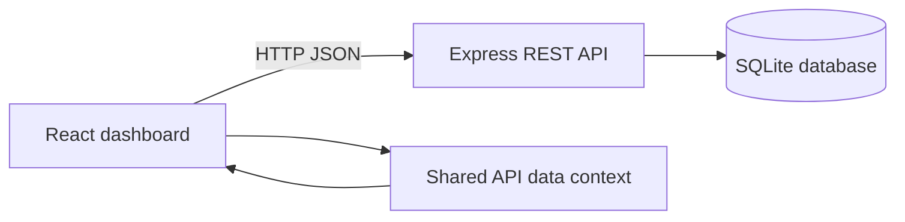

# DabbaDash — LastMile Bite Battle

DabbaDash is a hyperlocal cloud-kitchen operations dashboard for managing orders from kitchen preparation through courier dispatch and delivery. A React dashboard consumes a local Express REST API backed by SQLite.

## Problem and solution

Cloud-kitchen operators need one view of order progress, kitchen workload, courier availability, and delivery handoffs. DabbaDash brings those workflows together in one dashboard, with shared order data and a lightweight local API.

## Features

- **Overview:** order KPIs, brand distribution, kitchen activity, and delayed-kitchen alerts.
- **All Orders:** search and filter the API-backed order list.
- **Kitchen Board:** advance orders through Received, In Kitchen, Packed, Out for Delivery, and Delivered.
- **Rider Dispatch:** review available couriers and recommendations, assign a courier, and update courier availability.
- **Delivery Batching:** generate batches from Packed orders, review distance and courier recommendations, assign a courier, and advance batch status.
- **Live Map:** inspect order and courier markers with details on a schematic demo map.
- **Customer Tracking:** search orders and view current status, courier, progress, and a demo ETA.
- **Analytics:** current order totals and distributions by status and brand, delivered/active counts, and recorded kitchen preparation times.

## Technology

- React 18, TypeScript, Vite, Tailwind CSS
- Lucide React icons and Recharts
- Node.js, Express 4, TypeScript, `better-sqlite3` (SQLite)

## Architecture



The frontend API client uses `VITE_API_BASE_URL`. `ApiDataContext` shares brands, orders, couriers, zones, and batches between pages; live data refreshes periodically, and pages are split into lazy-loaded bundles. The backend creates or migrates the SQLite schema on startup and returns JSON data and errors. Express application configuration is kept separate from server startup, enabling isolated integration tests without opening the canonical database.

## Project structure

```text
.
├── backend/
│   ├── src/
│   │   ├── db/              # SQLite connection, schema/migrations, seed data
│   │   ├── routes/api.ts    # REST endpoints and business rules
│   │   ├── app.ts           # Express middleware, docs and error handling
│   │   ├── logger.ts        # Sanitized structured operational logs
│   │   ├── openapi.ts       # Verified OpenAPI 3.0 API contract
│   │   ├── types/           # API and database types
│   │   └── index.ts         # Server startup and shutdown
│   ├── test/                # Isolated API integration tests
│   ├── data/                # Local SQLite database (ignored by Git)
│   └── package.json
├── src/
│   ├── components/          # Shared layout, UI, and overview components
│   ├── contexts/            # Shared API-backed dashboard state
│   ├── pages/               # The eight dashboard pages
│   ├── services/            # Centralized frontend API client
│   └── analytics.ts         # Kitchen timing and alert calculations
├── .env.example             # Frontend API URL example
└── package.json
```

## Prerequisites

- Node.js 20 or newer and npm.
- The project uses `better-sqlite3`, which includes a native SQLite binding. Install dependencies in both the project root and `backend/`.
- The current backend is a local demonstration API. It has no user authentication or authorization and must not be exposed directly to the public internet.

## Installation and development

Open two terminals from the project root.

**Frontend terminal:**

```powershell
npm install
Copy-Item .env.example .env
npm run dev
```

Vite serves the dashboard at `http://localhost:5173`.

**Backend terminal:**

```powershell
Set-Location backend
npm install
npm run dev
```

The API listens at `http://localhost:3000` by default. On development startup it creates or migrates the schema and inserts the existing demo fixtures only when all application tables are empty. It never replaces populated records. `npm run db:seed` is also available for an explicit, repeatable seed attempt and skips databases that already contain records.

For production builds:

```powershell
# From the project root
npm run build
npm run preview

# From backend/
npm run typecheck
npm run build
npm start
```

Run the frontend lint checks with `npm run lint` from the project root. Backend integration tests use Node's built-in test runner and an isolated temporary SQLite database; they do not seed, read, or modify `backend/data/dabbadash.db`.

```powershell
Set-Location backend
npm test
npm run typecheck
npm run typecheck:test
npm run build
```

## Environment variables

| Variable | Used by | Default | Description |
|---|---|---|---|
| `VITE_API_BASE_URL` | Frontend | `http://localhost:3000/api` | API base URL used by the Vite app. Set it in the root `.env` file. |
| `HOST` | Backend | `127.0.0.1` | Address used by the API listener. The default is loopback-only; do not bind publicly without adding authentication and deployment protections. |
| `PORT` | Backend | `3000` | Express listening port. |
| `CORS_ORIGIN` | Backend | `http://localhost:5173,http://127.0.0.1:5173` | Comma-separated allowed browser origins. |
| `DABBADASH_DB_PATH` | Backend | `backend/data/dabbadash.db` | Optional absolute path for the SQLite database. |
| `DABBADASH_DEMO_SEED` | Backend | Enabled outside production | Set to `false` to disable automatic empty-database seeding, or `true` to enable it explicitly. |

The checked-in `.env.example` contains only the frontend API URL. Do not put secrets in it; local `.env` files and SQLite databases are excluded from Git. CORS is not authentication: non-browser clients can call the local API.

## REST API

All data endpoints return a `{ "data": ... }` envelope. Errors use `{ "error": { "code": "...", "message": "..." } }`.
The generated OpenAPI 3.0 JSON document is available while the backend is running at `http://localhost:3000/api/openapi.json`.

| Method | Endpoint | Purpose |
|---|---|---|
| `GET` | `/api/health` | Check server and database availability. |
| `GET` | `/api/brands` | List brands. |
| `GET` | `/api/brands/:id` | Get a brand. |
| `GET` | `/api/orders` | List orders. |
| `GET` | `/api/orders/:id` | Get an order. |
| `POST` | `/api/orders` | Create an order from existing brand/menu data. |
| `PATCH` | `/api/orders/:id/status` | Change an order status. |
| `GET` | `/api/orders/:id/recommended-couriers` | Recommend eligible couriers for an order. |
| `PATCH` | `/api/orders/:id/assign-courier` | Assign a courier to an order. |
| `GET` | `/api/couriers` | List couriers and active workloads. |
| `GET` | `/api/couriers/:id` | Get a courier. |
| `PATCH` | `/api/couriers/:id/status` | Update courier availability. |
| `GET` | `/api/zones` | List delivery zones and current counts. |
| `GET` | `/api/batches` | List delivery batches. |
| `GET` | `/api/batches/:id` | Get a batch and its orders. |
| `GET` | `/api/batches/:id/recommended-couriers` | Recommend couriers for a batch. |
| `POST` | `/api/batches/generate` | Generate batches from eligible Packed orders. |
| `POST` | `/api/batches` | Create a batch with `{ "orderIds": [1, 2] }`. |
| `PATCH` | `/api/batches/:id/assign-courier` | Assign a courier to a pending batch. |
| `PATCH` | `/api/batches/:id/status` | Advance or cancel a batch. |

Order statuses progress one step at a time through `Received`, `In Kitchen`, `Packed`, `Out for Delivery`, and `Delivered`; repeated requests for the current status are idempotent. Orders in active batches are advanced through the batch workflow: starting a batch moves its orders to `Out for Delivery`, and completing it moves them to `Delivered`. The API also preserves and returns legacy `Cancelled` orders. Batch statuses are `pending`, `assigned`, `in-progress`, `completed`, and `cancelled`.

## Database and seed data

The canonical backend is `backend/`. Its SQLite file defaults to `backend/data/dabbadash.db`; the database and SQLite sidecar files are ignored by Git. Schema changes are additive migrations. To seed a new local database:

```powershell
Set-Location backend
npm run db:seed
```

To use a separate database, set `DABBADASH_DB_PATH` to an absolute path before running the seed command or server. The seed operation does not overwrite existing records; if brands already exist, it skips fixture insertion.

## Demo workflow

1. Start the frontend and backend using the commands above.
2. Create an order through `POST /api/orders` using an existing brand and menu item, or select an existing order.
3. Advance it on the Kitchen Board to **In Kitchen**, then **Packed**.
4. Generate a batch from eligible Packed orders and assign one of the recommended available couriers.
5. Inspect the assigned order and courier on the Live Map, then search the order in Customer Tracking.
6. Advance the order to **Out for Delivery** and **Delivered**; review the updated orders and Analytics.

The backend exposes a health check at `http://localhost:3000/api/health`. Its `demoData` field identifies the seeded fixture database. If the API cannot be reached, the frontend displays a clearly marked, read-only local demo snapshot; changes are not persisted in that mode.

For quick checks, open `http://localhost:3000/api/health` and `http://localhost:3000/api/brands`, or use the dashboard's Refresh control. The API's `POST /api/orders` endpoint accepts existing brand/menu-item IDs; the frontend does not currently provide a restaurant storefront, menu browser, or cart checkout.

## Screenshots

Screenshots are not included in this repository yet.

- Overview: _Screenshot placeholder — add `docs/screenshots/overview.png` when available._
- Live Map: _Screenshot placeholder — add `docs/screenshots/live-map.png` when available._
- Analytics: _Screenshot placeholder — add `docs/screenshots/analytics.png` when available._

## Known limitations

- Live Map positions are simulated. The map is a schematic SVG view; zone circles and anchors are illustrative, not geographic boundaries or real GPS.
- Delivery batching uses real order coordinates only when supplied. Otherwise it labels and uses simulated zone-based locations; reported distances are approximate straight-line estimates.
- Customer delivery ETAs are explicitly demo estimates, not route-aware predictions.
- Preparation analytics and 20-minute alerts rely on kitchen-stage timestamps recorded by the current API. Older orders without those timestamps are excluded until they pass through the kitchen status transitions again.
- The dashboard is a local demo without authentication, customer notifications, or production hosting configuration. Settings and Log Out are intentionally disabled demo placeholders.
- The OpenAPI document is served locally for development/demo use. Authentication is deferred to preserve the existing no-login dashboard workflows; API writes remain unauthenticated.
- User registration/login, customer restaurant browsing, and cart checkout are not implemented in the existing operations-dashboard architecture.
- All API write routes are unauthenticated. The backend defaults to loopback binding to avoid exposing them on the local network; this is not a substitute for production authentication, authorization, HTTPS, and deployment hardening.

## Future enhancements

- Integrate a real mapping/geocoding provider and opted-in courier GPS.
- Add authentication, roles, and operational settings.
- Add customer notifications and route-aware delivery estimates.
- Expand the automated API tests with browser/component coverage and complete production authentication/deployment hardening.